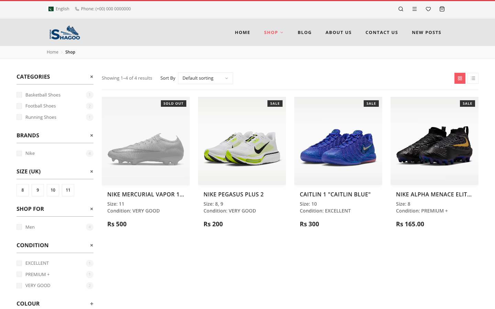
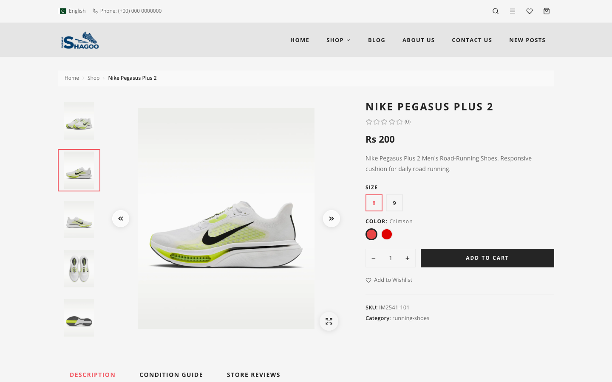

# Ecommerce Store

[](https://github.com/hussain-gull/ecommerce-store/actions/workflows/ci.yml)
[](LICENSE)
[](.nvmrc)
[](CONTRIBUTING.md)

A full-stack e-commerce platform for a footwear store: a Next.js storefront, a React admin panel, and an Express + Prisma REST API in one Turborepo monorepo, sharing a single set of TypeScript types and Zod schemas.

Prices are in **PKR** and customers pay by **JazzCash** (they upload a payment screenshot at checkout; an admin reviews it and confirms the order).

**Contents:** [Screenshots](#screenshots) · [Features](#features) · [Tech stack](#tech-stack) · [Repository layout](#repository-layout) · [Getting started](#getting-started) · [Configuration](#configuration) · [Customize and rebrand](#customize-and-rebrand) · [Scripts](#scripts) · [Documentation](#documentation) · [Security](#security) · [Contributing](#contributing) · [License](#license)

## Screenshots

| Shop with filters                                                                                   | Product page                                                                                          |
| --------------------------------------------------------------------------------------------------- | ----------------------------------------------------------------------------------------------------- |
|  |  |

_Storefront running locally with sample catalogue data. Product names and photos are sample data, and the trademarks and images belong to their owners._

## Features

**Storefront** (`apps/web`)

- Product catalogue with filters, price range and typo-tolerant search suggestions
- Cart and wishlist that persist per user and merge on login
- Checkout with address book and JazzCash payment-proof upload
- Account area, order history, password reset by email
- Product reviews with photo/video uploads
- Editable pages (home, about, contact, blog, condition guide), SEO metadata, sitemap, `robots.txt`, JSON-LD

**Admin panel** (`apps/admin`)

- Separate admin login (own JWT secret, cookie and table)
- Dashboard with charts, order review (confirm / cancel / status), payment-proof hints via OCR
- Product, filter-option, page-content and contact-message management

**API** (`apps/api`)

- Route → controller → service layering, Zod-validated input, uniform response envelope
- Short-lived access tokens + HttpOnly refresh cookie, with revocation on logout and password reset
- Rate limiting, Helmet, strict CORS allowlist, Origin check on writes, hardened image/video uploads
- Redis read-through cache (optional), Cloudinary media, Resend email

## Tech stack

| Area       | Technology                                                   |
| ---------- | ------------------------------------------------------------ |
| Storefront | Next.js 16, React, Tailwind CSS, Zustand, Framer Motion      |
| Admin      | React, Vite, React Router, shadcn/ui, Recharts, Tailwind CSS |
| API        | Node.js, Express 5, Zod 4, JWT, bcrypt                       |
| Database   | PostgreSQL via Prisma ORM 8 (RC)                             |
| Cache      | Redis                                                        |
| Services   | Cloudinary (media), Resend (email)                           |
| Tooling    | pnpm workspaces, Turborepo, TypeScript, ESLint, Prettier     |

## Repository layout

```
apps/
  web/        Next.js storefront         (port 3000)
  admin/      Vite + React admin panel   (port 5173)
  api/        Express + Prisma API       (port 4000)
packages/
  contracts/  @ecommerce/contracts: shared types + Zod schemas + money/shipping helpers
  ui/         @repo/ui: shared component stubs
  eslint-config/, typescript-config/
```

Each app has a `CONTEXT.md` (overview, reference and conventions); read it before contributing. Never duplicate a type or schema locally: import it from `@ecommerce/contracts`.

## Getting started

### Prerequisites

- Node.js **24+** and **pnpm 12**
- PostgreSQL (with permission to `CREATE EXTENSION`)
- Redis (optional locally; used for caching and token revocation)
- Free [Cloudinary](https://cloudinary.com) and [Resend](https://resend.com) accounts for uploads/email (without a Resend key, emails are printed to the console)

### Setup

```bash
git clone https://github.com/hussain-gull/ecommerce-store.git
cd ecommerce-store
pnpm install

# API configuration
cp apps/api/.env.example apps/api/.env      # fill in DATABASE_URL, JWT_SECRET, ADMIN_JWT_SECRET, ...

# Frontend configuration
cp apps/web/.env.example apps/web/.env.local
cp apps/admin/.env.example apps/admin/.env
```

Create the database schema and initial data (see [`apps/api/CONTEXT.md`](apps/api/CONTEXT.md#database-setup) for details):

```bash
cd apps/api
pnpm prisma db update     # first-time schema
pnpm seed:admin           # admin login from ADMIN_NAME / ADMIN_EMAIL / ADMIN_PASSWORD
pnpm seed:content         # page copy (home, about, contact, ...)
```

Run everything:

```bash
pnpm dev                  # all apps
pnpm dev --filter web     # http://localhost:3000
pnpm dev --filter admin   # http://localhost:5173
pnpm dev --filter api     # http://localhost:4000
```

Generate secrets with `openssl rand -hex 32` (use a different value for `JWT_SECRET` and `ADMIN_JWT_SECRET`).

## Configuration

The API reads its settings from `apps/api/.env`; the full annotated list is in [`apps/api/.env.example`](apps/api/.env.example) and the production table is in [DEPLOYMENT.md](./DEPLOYMENT.md#2-environment-variables). Key variables:

| Variable                         | Purpose                                  |
| -------------------------------- | ---------------------------------------- |
| `DATABASE_URL`                   | PostgreSQL connection string             |
| `JWT_SECRET`, `ADMIN_JWT_SECRET` | Token signing (32+ chars, must differ)   |
| `CORS_ORIGINS`                   | Comma-separated allowed frontend origins |
| `REDIS_URL`                      | Cache + refresh-token revocation         |
| `CLOUDINARY_*`                   | Media uploads                            |
| `RESEND_API_KEY`, `EMAIL_FROM`   | Transactional email                      |

Never commit `.env` files. Only `NEXT_PUBLIC_*` / `VITE_*` values reach the browser.

## Customize and rebrand

Branding and static copy live in JSON files, so you can make the store your own without touching components:

| What                                                                                                                                                | File                                                                                                          |
| --------------------------------------------------------------------------------------------------------------------------------------------------- | ------------------------------------------------------------------------------------------------------------- |
| Store name, short name (email header), display name, admin title, description, logo path (used by storefront, admin panel, SEO metadata and emails) | [`packages/contracts/src/branding.json`](packages/contracts/src/branding.json)                                |
| Header phone, footer contacts/social text, copyright year                                                                                           | [`apps/web/content/branding.json`](apps/web/content/branding.json)                                            |
| Page copy: home, about, contact, blog, condition guide (seeded into the DB, then editable in the admin panel)                                       | [`apps/api/scripts/seed-data/*.json`](apps/api/scripts/seed-data) then `pnpm seed:content -- --force`         |
| Logo and favicon files                                                                                                                              | `apps/web/public/`, `apps/admin/public/`                                                                      |
| Sender name/address, cookie names, Cloudinary folder                                                                                                | `EMAIL_FROM`, `REFRESH_COOKIE_NAME`, `ADMIN_REFRESH_COOKIE_NAME`, `CLOUDINARY_ROOT_FOLDER` in `apps/api/.env` |
| Currency and shipping rates                                                                                                                         | `packages/contracts/src/currency.ts`, `shipping.ts`                                                           |

Products, filter options and prices are managed in the admin panel (stored in the database), not in JSON. Before deploying your own copy, replace the sample phone number and email in `apps/web/content/branding.json`.

## Scripts

```bash
pnpm build         # build all apps/packages
pnpm lint          # lint
pnpm check-types   # type-check
pnpm format        # prettier --write
```

Scope to one package with `--filter=<name>`, e.g. `pnpm build --filter=web`.

API integration tests run against a scratch database only:

```bash
TEST_DATABASE_URL=postgresql://.../store_test pnpm --filter api test:integration
```

## Documentation

- [API reference and architecture](apps/api/CONTEXT.md), [storefront](apps/web/CONTEXT.md), [admin panel](apps/admin/CONTEXT.md)
- [Deployment checklist](DEPLOYMENT.md)
- [Monorepo conventions](AGENTS.md)

## Security

See [SECURITY.md](SECURITY.md). Please **do not open a public issue** for vulnerabilities; report them privately via the repository's Security tab.

Known, accepted gaps: no MFA for the admin account, per-instance rate-limit counters, and the storefront CSP is report-only. See [DEPLOYMENT.md](DEPLOYMENT.md#known-gaps-accepted-for-launch).

## Trademarks and brand assets

The code is MIT-licensed. The "SHAGOO FOOTWEAR" name, logo and the sample images in `apps/*/public` belong to the original author and are **not** licensed for reuse. The defaults in the code are generic ("My Store"); replace the logo and favicon with your own before launching a store.

## Contributing

Contributions are welcome.

See [CONTRIBUTING.md](CONTRIBUTING.md) for the full guide. By participating you agree to the [Code of Conduct](CODE_OF_CONDUCT.md). In short:

1. Fork the repo and create a branch: `git checkout -b feat/my-change`
2. Read [`AGENTS.md`](AGENTS.md) and the `CONTEXT.md` of the app you touch
3. Make your change; run `pnpm lint`, `pnpm check-types` and `pnpm format`
4. Open a pull request describing what changed and why

For larger changes, please open an issue first to discuss the approach.

## License

Released under the [MIT License](LICENSE). Copyright (C) 2026 Hussain-Gull. You are free to use, modify and distribute this software, including commercially, as long as the copyright notice is kept.
